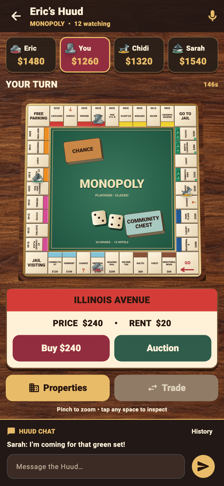

# Monopoly — first playable implementation

**Branch: `codex/monopoly-classic-depth`.** The game description and approved concept were committed in `9a6626c` before application or backend code was added.

## Implemented

- **Classic 40-space board for 2–8 selected players:** automatic bank, starting cash, server dice, GO, purchases, round-roster auctions, rents, doubles, jail and both shuffled card decks.
- **Property management:** even building and selling, 32-house/12-hotel bank inventory, group sales when a hotel cannot be exchanged for replacement houses, mortgages, redemption and mortgage transfer interest.
- **Private bilateral trades:** cash and deeds, atomic acceptance with fresh ownership/funds checks, public completed exchanges. Pending offers and future randomness never enter spectator snapshots.
- **Debt and bankruptcy:** cash-raising decisions, creditor transfers and auctions of bank-held estates. Conservative 180-second decision timeouts; disconnecting alone never bankrupts a player.
- **Huud integration:** separate admission and play requests, admin selection and start, locked match roster, viewers, existing voice/mic moderation, persistent Huud chat and return to the same Huud after a game.
- **A host may watch:** in a waiting Monopoly roster the host can release their own seat, select up to eight other players, open the lobby and start. Only that room's authenticated host gains the control connection without a player seat. Monopoly does not transfer game administration when the host briefly disconnects. Other games retain their existing lobby behavior.
- **Bold classic screen:** warm walnut material, slight overhead perspective, beveled ivory tiles, raised colour bands, green felt, shaded metal tokens, houses/hotels, dice, heavy cash/decision labels, zoom, a large deed inspector and reduced-motion token transitions.
- **Visible bottom chat:** the recent message, text box and Send control remain on screen. History opens separately. Huud membership permissions govern sending; failed sends retain the draft.
- **Temporary network loss:** the board and recent chat are cached per account and room. Private trade offers are excluded from the saved view. Actions remain disabled until a live connection and snapshot are available.



The preview is a 390 × 844 phone viewport at 2× resolution. Its sample positions/cash come from the real engine's canonical board snapshot, not from a second board definition.

## Validation

- **26 Monopoly rule tests**, including auction turn authority, idempotency, even building, stock shortages, stale/private trades, mortgage interest, cards, jail, bankruptcy and twelve 4,000-decision simulations.
- **API snapshot and capacity tests:** reconnect delivers the full board and only the subscriber's own private offers; spectators receive no deck, seed or offer data. Huud capacity comes from the engine's limit.
- **35 Huud database integration tests:** temporary local PostgreSQL and Redis; includes separate join/play requests, admin-only start, player mic permission, chat/audience persistence and an organising host without a game seat.
- **Migration V48 applied successfully.** A separate transaction tested that the same migration adds Monopoly while preserving an existing SlayHuud registration.
- **Local Android arm64 debug APK compiled successfully.**
- **65 Flutter screen/layout and Huud regression tests passed:** active decisions, spectator/read-only controls, saved offline views, cached-snapshot reconnect handling, persistent chat endpoints, private-offer cache exclusion, large text, narrow phones and keyboard placement. Existing Huud/mic/resume tests run alongside them.

Reproduce the core checks from the repository root:

```sh
./backend/mvnw -f backend/pom.xml -pl ta-api -am test
cd app
flutter test test/monopoly_game_test.dart test/monopoly_table_test.dart test/huud_space_test.dart test/huud_mic_request_test.dart test/game_resume_test.dart
```

The database suite is `HuudSpaceIT` under `ta-app`. It supports temporary external database properties (`it.r2dbc.url`, `it.jdbc.url`, `it.db.user`, `it.db.password`, `it.redis.port`), used here because this machine's Docker version is newer than the existing Testcontainers client's supported API.

## Release boundaries

**This is isolated branch work.** Production deployment, installation on the phone and a merge into main are separate release steps. The app must run with the corresponding Monopoly-enabled backend.

The shared ordinary-game runtime remains in memory, as for the existing games. **Reconnect to a running server is supported; recovery after a server process restart is not added here.** Durable checkpoints should be addressed before relying on long Monopoly matches across backend deployments.

**Cyber Agents:** the host can add agents from the Huud roster. They choose only engine-validated actions from their own player snapshot, including purchase/auction, jail, debt, property management and trade responses. An economical fallback keeps games moving without model credentials. Private offers stay out of spectator state and Huud chat is never passed to the move picker.

**Deliberate V1 limits:** no agent-initiated trades, no simultaneous building-stock auctions, no jail-card trading, and no parallel matches inside one Huud. A large property sheet and private offer composer provide the first management UI; further polish can follow human multiplayer testing.

The wood texture is a generated material, with its exact prompt and generation mode in [the asset note](../../app/assets/images/monopoly/README.md). The bundled fonts retain their [license](../../app/assets/fonts/monopoly/LICENSE.txt).

## Test mirror and background fix

The user requested a complete production PostgreSQL snapshot in isolated test. See [test setup](../../infra/TEST_ENVIRONMENT.md). The new **V49** migration adds the already offered Blank background to the database constraint; V43 previously rejected it during updates. All public HTTP/game errors and app error presentations use **“Error has occurred, try again later.”** Status codes and safe machine outcomes remain available for app navigation; SQL and exception details stay in server logs.
