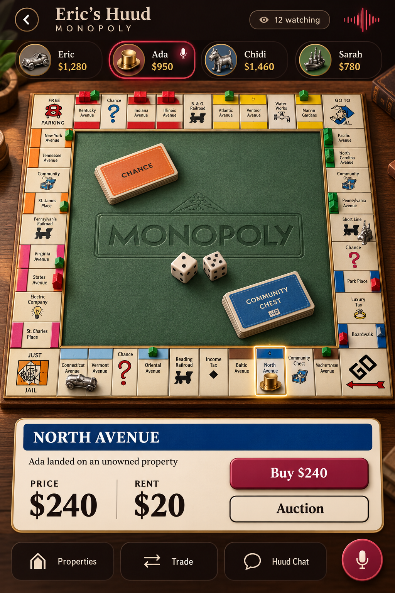

# Monopoly — classic board with depth

Approved direction · 10 October 2026. The [game description](GAME_DESCRIPTION.md) was committed before coding. The first implementation is on `codex/monopoly-classic-depth`; see [implementation and checks](IMPLEMENTATION.md).

## Visual direction

Keep the familiar square board as the main screen. Give it the physical depth of a premium tabletop game: a thick walnut base, beveled ivory spaces, green felt, raised colour strips, small houses and hotels, and reflective metal tokens. Use a gentle overhead tilt so the whole perimeter stays visible. PlayHuud's maroon, warm cream and brass frame the game.

This image establishes the visual direction. Property names, prices, tile arrangement and building placements are illustrative; the finished board must come from the agreed rules and actual game state.

## Main screen

- Header: Huud name, game name, viewer count and voice activity.
- Player strip: token, name, cash and current-turn highlight. Players have mic access by default.
- Board: overview of all spaces, tokens, ownership and buildings. Tap a space to see its full details; allow zoom for small screens.
- Decision area: large readable card and actions for the current phase. A buying decision shows Buy and Auction; a turn awaiting a roll shows Roll Dice. Only eligible players can act.
- Bottom controls: Properties and Trade sheets, with a **permanently visible Huud chat composer and recent message** underneath. Chat history expands separately. The Huud microphone remains available in the header.

Use depth in tiles, materials, lighting and shadows. Keep buttons and text stable during movement. Dice tumble, tokens step between spaces, and houses appear when built. Reduce-motion mode uses short transitions; offer simpler rendering for devices that need it. Prototype a board with layered artwork and a mild perspective transform before committing to a full 3D renderer.

## Game plan

The proposed first version covers token selection, dice and movement, property purchase, auctions, rent, colour groups, houses/hotels, trading, mortgages, card effects, jail, bankruptcy and a final result. The bank is automatic; organising a Huud must not give a player control over dice, money or other players' assets.

Use the selected rules to define roster capacity. The four-player mockup illustrates layout, not a fixed player limit. Confirm the board edition, names, currency and exact rules before writing the engine. Choose a clear reconnect and abandoned-turn policy before implementation; temporary network loss must not immediately bankrupt a player.

## Huud integration

Keep the existing flow: a viewer requests to join the Huud and receives mic access when admitted. Joining the game is separate: the admin selects Monopoly, participants request to play, the admin selects the roster and starts the match. Lock that roster for the match.

The game owns turns, money, property, offers and results. The Huud owns participants, viewers, voice and chat. Host navigation or absence does not stop the game. Only the permanent owner can end the Huud's live session. Existing safety and inactivity rules continue to apply.

The server validates actions and supplies the authoritative state. Spectators receive the public board, balances, ownership, buildings and resolved public events. They must not receive upcoming dice, deck order or private pending trade offers. Disconnects and reconnects restore the confirmed game state.

## Proposed build sequence

1. Approve the visual direction, board edition and reconnect policy.
2. Prototype the board and property drawer on a real phone; check readability, touch targets and animation performance.
3. Implement the rules engine, including auctions, trades and bankruptcy. Test economic transitions and turn permissions.
4. Connect the existing Huud roster, voice, chat and spectator contracts. Verify private/public state separation.
5. Play full multiplayer matches, including reconnects, host absence, results and rematch in the same Huud.

The reference image remains the approved visual target. The [phone preview](phone-preview-v1.png) is rendered from the actual Flutter implementation and a server-generated board snapshot.
